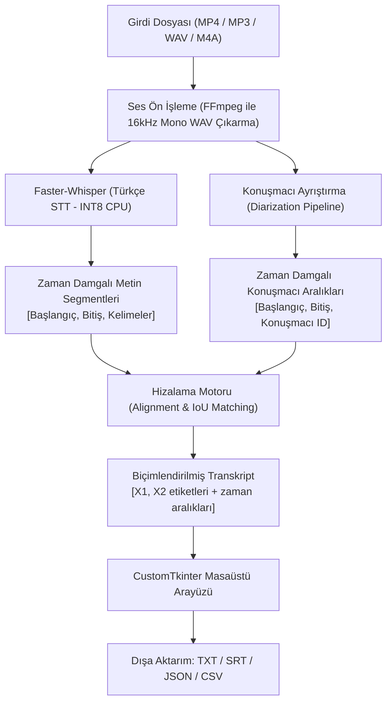

# Plan: Türkçe Ses Tanıma ve Konuşmacı Ayrıştırma Aracı (Speech-To-Text & Diarization)

MP4 ve MP3 gibi video/ses dosyalarını tamamen yerel (offline) olarak Türkçe metne dönüştüren, farklı konuşmacıları otomatik tespit edip **"X1", "X2"** şeklinde etiketleyen modern bir masaüstü uygulaması (`CustomTkinter`) geliştirme planıdır.

---

## Sistem ve Donanım Analizi
Mevcut çalışma ortamı incelenmiştir:
- **İşlemci:** 12th Gen Intel Core i3-12100 (4 çekirdek, 8 iş parçacığı)
- **Bellek (RAM):** 8 GB RAM
- **Grafik Birimi:** Intel UHD Graphics 730 (Harici NVIDIA CUDA GPU yok)
- **İşletim Sistemi:** Windows (PowerShell)
- **Python:** 3.13.7 (64-bit)

> [!IMPORTANT]
> Sistemde harici bir NVIDIA GPU bulunmadığı için model mimarisi **CPU üzerinde maksimum verimlilik ve düşük bellek tüketimi (INT8 CTranslate2 optimizasyonu)** sağlayacak şekilde yapılandırılmalıdır.

---

## 1. Mimari Tasarım ve İşlem Akışı



---

## 2. Temel Modüller ve Bileşenler

### A. Ses Ön İşleme Modülü (`audio_processor.py`)
- MP4 (video) veya MP3/M4A/WAV ses dosyalarından sesi otomatik ayıklar.
- Konuşma tanıma ve ayrıştırma modellerinin beklediği standart format olan **16.000 Hz, tek kanal (Mono), 16-bit PCM WAV** biçimine dönüştürür.
- `ffmpeg` sistemde kurulu değilse otomatik tespit eder ve yerel static binary veya winget ile çalışmasını sağlar.

### B. Türkçe Konuşma Tanıma Modülü (`transcriber.py`)
- **Motor:** `faster-whisper` (CTranslate2 tabanlı, standart OpenAI Whisper'a göre CPU'da 4 kata kadar daha hızlı ve %60 daha az RAM harcar).
- **Optimizasyon:** `compute_type="int8"` ve `cpu_threads=4` (i3-12100 için en ideal yapılandırma).
- **Model Seçenekleri (Kullanıcı arayüzünden seçilebilir):**
  - `base` (~140 MB): Ultra hızlı, temel konuşmalar için.
  - `small` (~460 MB - **Önerilen & Varsayılan**): Türkçe doğruluğu ve kelime hatası (WER) dengesi CPU için en mükemmel seviyededir.
  - `medium` (~1.5 GB): Karmaşık ve teknik terimlerin yoğun olduğu sesler için opsiyonel.
- **Dil Parametresi:** Varsayılan olarak `"tr"` (Türkçe) kilitlenir, modelin dil tespit gecikmesi engellenir.

### C. Konuşmacı Ayrıştırma Modülü (`diarizer.py`)
- **İki Kademeli Mimari:**
  1. **Birincil (Yüksek Doğruluk):** `pyannote.audio` Speaker Diarization Pipeline (Kullanıcı ücretsiz HuggingFace Token girdiğinde devreye girer).
  2. **İkincil / Yedek (Token-Free & Hafif):** Silero VAD (Ses Etkinliği Tespiti) + Akustik Spektral Kümeleme (Kullanıcının HF token'ı olmasa bile sıfır ayarla konuşmacıları ayırabilir).
- Konuşmacı segmentlerini `SPEAKER_00`, `SPEAKER_01` biçiminde çıkarıp kullanıcının isteği doğrultusunda **`X1`**, **`X2`**, **`X3`** etiketlerine dönüştürür.
- İsteğe bağlı olarak konuşmacı sayısını sabitleme (örneğin iki kişilik bir mülakat için `min_speakers=2, max_speakers=2`) imkanı sunar.

### D. Hizalama ve Birleştirme Modülü (`aligner.py`)
- Whisper segmentleri ile Diarization zaman aralıklarını çakıştırır (Intersection-over-Union / Max Overlap).
- Aynı konuşmacının ardışık cümlelerini mantıklı paragraflar halinde birleştirir.
- Çıktı formatı örneği:
  ```text
  [00:00:01 - 00:00:05] X1: Merhaba, bugünkü toplantımıza hoş geldiniz.
  [00:00:06 - 00:00:12] X2: Teşekkürler, ilk gündem maddesi olan proje takvimini inceleyebiliriz.
  [00:00:13 - 00:00:18] X1: Elbette, ilk fazı bu hafta tamamlamayı hedefliyoruz.
  ```

### E. Dışa Aktarım Modülü (`exporter.py`)
- **Düz Metin (`.txt`):** Okunabilir konuşmacı ve zaman etiketli tam transkript.
- **Altyazı Dosyası (`.srt`):** Video oynatıcılar için konuşmacı adları içeren standart altyazı.
- **Yapılandırılmış Veri (`.json`):** Başlangıç, bitiş milisaniyeleri ve kelime güven skorları.

---

## 3. Masaüstü Kullanıcı Arayüzü (`CustomTkinter`)

Modern, şık ve koyu/açık tema destekli masaüstü penceresi:

1. **Üst Panel:**
   - Dosya Seçme Alanı (MP4 / MP3 / WAV seçimi veya Sürükle-Bırak).
   - Dosya bilgisi (Dosya adı, süre, boyut).
2. **Ayar Kartı:**
   - **Model Seçimi:** `base` / `small (Önerilen)` / `medium`.
   - **Konuşmacı Sayısı:** Otomatik tespit veya elle belirleme (Örn: 2).
   - **Etiket Formatı:** `X1, X2...` / `Konuşmacı 1, Konuşmacı 2...` / İsim girme.
   - **Hugging Face Token:** İsteğe bağlı API Token kutusu (Güvenli olarak kaydedilir).
3. **İşlem ve İlerleme:**
   - Büyük "Transkripsiyonu Başlat" butonu.
   - Adım adım ilerleme çubuğu (*Ses dönüştürülüyor -> Metne dökülüyor -> Konuşmacılar ayrıştırılıyor -> Hizalanıyor*).
   - Canlı durum mesajları.
4. **Sonuç ve Düzenleme Alanı:**
   - Renkli konuşmacı rozetleriyle zengin metin kutusu.
   - **Hızlı Konuşmacı Yeniden Adlandırma:** Örneğin "X1" etiketini tek tıkla "Ahmet Yılmaz" yaparak tüm metinde güncelleme.
   - Metin arama ve doğrudan düzenleme.
   - **Dışa Aktar** butonları (TXT, SRT, JSON).

---

## 4. Proje Dizin Yapısı

`E:\Speech-To-Text` dizininde oluşturulacak yapı:

```
E:\Speech-To-Text\
│
├── src\
│   ├── __init__.py
│   ├── config.py                 # Uygulama ayarları, yol tanımları
│   ├── audio_processor.py        # FFmpeg ses ayrıştırma ve dönüştürme
│   ├── transcriber.py            # Faster-Whisper Türkçe konuşma tanıma
│   ├── diarizer.py               # Konuşmacı ayrıştırma motoru
│   ├── aligner.py                # Whisper & Diarization zaman hizalama
│   ├── exporter.py               # TXT / SRT / JSON çıktı üretici
│   └── ui\
│       ├── __init__.py
│       ├── app.py                # CustomTkinter ana pencere ve sekmeler
│       └── components.py         # Konuşmacı rozetleri, kartlar, diyaloglar
│
├── models\                       # İndirilen yerel modellerin önbelleği
├── outputs\                      # Oluşturulan transkriptlerin kaydedileceği yer
├── tests\
│   └── test_pipeline.py          # Birim ve entegrasyon testleri
├── main.py                       # Uygulama başlatıcı
├── requirements.txt              # Gerekli kütüphaneler
├── setup_env.bat                 # Tek tıkla sanal ortam (venv) ve kurulum betiği
├── run.bat                       # Tek tıkla uygulamayı başlatma betiği
└── README.md                     # Kurulum ve kullanım kılavuzu (Türkçe)
```

---

## 5. Doğrulama ve Test Planı

### A. Otomatik Doğrulama
1. **FFmpeg Entegrasyon Testi:** Örnek bir MP4 dosyasından 16kHz mono WAV çıkarılmasının doğrulanması.
2. **Whisper Türkçe Testi:** Kısa bir Türkçe ses kaydı ile `faster-whisper` modelinin doğru Türkçe karakterleri (`ç, ğ, ı, ö, ş, ü`) ürettiğinin doğrulanması.
3. **Diarization & Alignment Testi:** Farklı iki kişinin konuştuğu örnek bir ses kaydında `X1` ve `X2` etiketlerinin doğru zaman aralıklarına atandığının doğrulanması.
4. **Dışa Aktarım Testi:** TXT, SRT ve JSON dosyalarının hatasız oluşturulduğunun kontrolü.

### B. Kullanıcı Kabul Testi
1. `run.bat` dosyasına çift tıklanarak masaüstü arayüzünün sorunsuz açılması.
2. Kullanıcının bir MP4 veya MP3 dosyası seçip "Başlat" butonuna basması.
3. Transkriptin ekranda `X1`, `X2` olarak listelenmesi ve konuşmacı isimlerinin değiştirilebilirliğinin test edilmesi.
4. "Dışa Aktar" ile çıktının kaydedilmesi.

---

## Kullanıcı Onayı Gereken Hususlar
> [!NOTE]
> 1. İlk çalıştırmada Faster-Whisper `small` modeli (~460 MB) bir defaya mahsus indirilecektir. İndirilen model `models/` klasöründe saklanacağı için sonrasında internete kesinlikle ihtiyaç duymayacaktır.
> 2. Pyannote kullanmak isterseniz Hugging Face üzerinden ücretsiz üyelik ile token alınabilir; token girmek istemezseniz uygulama hafif dahili konuşmacı ayrıştırma algoritmasını kullanacaktır.
> 3. Bu plan onaylandığında, sanal ortam kurulumu ve modüller adım adım geliştirilecektir.
